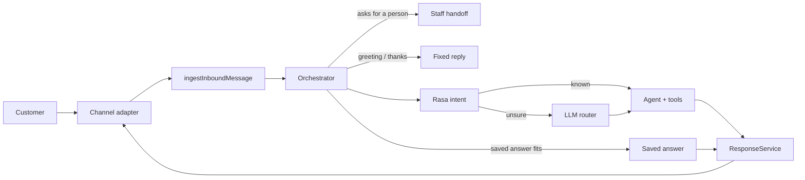

# Customer channels

Customers reach the business on **WhatsApp, website chat, email and phone calls**. Connect a
channel in the dashboard: **Channels → Add channel**, then open it to finish setup.

## Is it working?

Each channel card shows:

| Tag | Meaning |
|---|---|
| **Active / Inactive** | Whether the channel accepts messages. |
| **Connected / Setup needed** | Setup is complete (ids and keys are saved). |
| **Working: last customer message …** | A customer really reached you on it. This is the real proof. |

**Send test** on a card checks delivery: a test message for WhatsApp and website chat, and a
readiness check for phone lines (token saved, channel active, public `API_URL`).

## One pipeline for every channel

1. A person is asked for: handed to staff, no AI.
2. Greetings and thanks get a fixed reply (free).
3. [Rasa](rasa-nlu.md) classifies the message and picks the agent without a router LLM call;
   anything it is unsure about falls back to the LLM router.
4. [Saved answers](reply-engine.md) the owner approved are used first; the reply mode
   (Hybrid / No-AI / AI) decides how much AI is used.
5. Knowledge, booking and support agents answer with real data through tools. If AI is
   unavailable or the request can't be completed safely, a person is brought in.

## Channel setup

=== "WhatsApp"

    Phone number ID, verify token and permanent access token (Meta Cloud API), or a WAHA
    session. The page shows the callback URL to paste into Meta.

=== "Website chat"

    Copy the embed snippet into your site before `</body>`. The page has a live preview and
    title, colour and greeting settings.

=== "Phone calls"

    Add a *Phone calls (Twilio)* channel, set the Twilio number's voice webhook to the URL
    shown, and save your Twilio auth token. See [Phone calls](voice.md).
